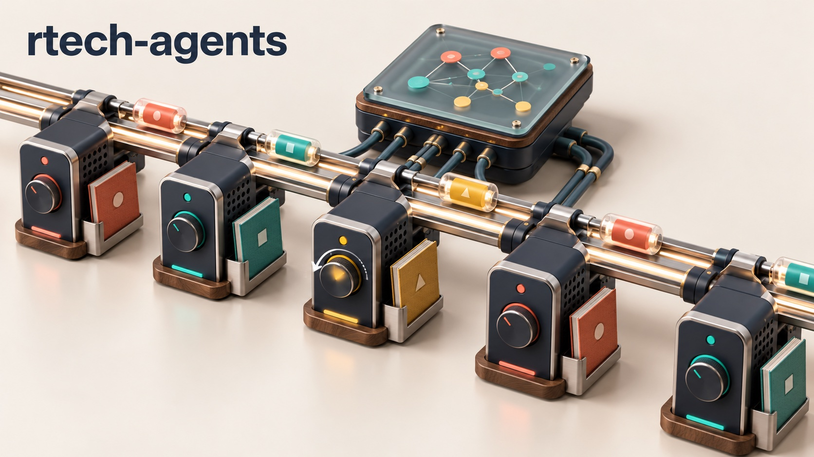
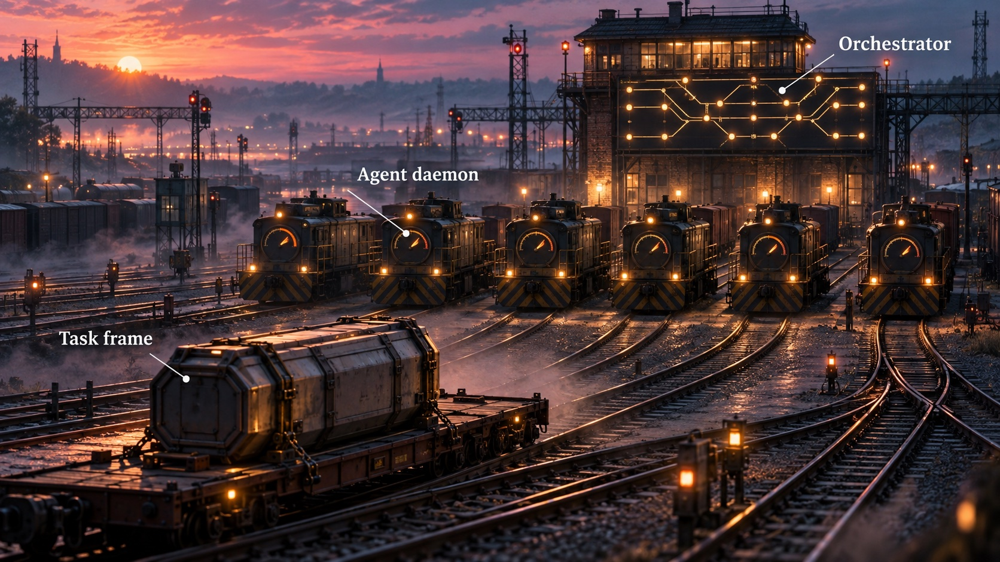
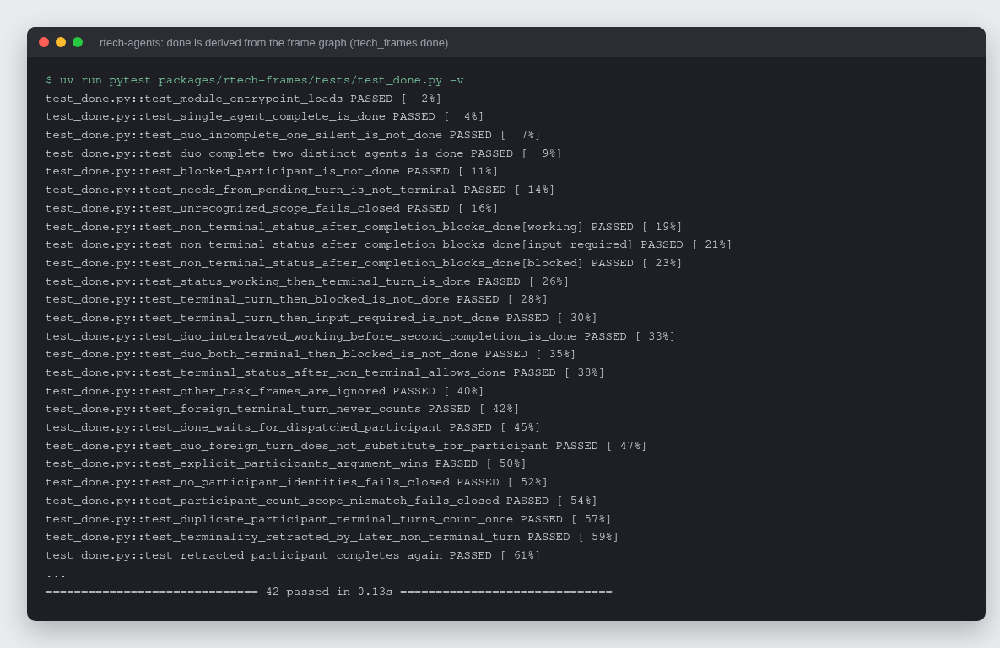

# rtech-agents

A runtime for long-running AI agents that people can steer while they work,
and that hand work to each other over a typed message bus instead of a chat
channel.

[](https://github.com/rodaddy/rtech-agents/actions/workflows/ci.yml)
[](LICENSE)




## What it is

Each agent is one persistent Claude (or Codex) session supervised by its own
daemon. People talk to the agents in Discord, Telegram or a small web chat and
can redirect an agent mid-task. Behind the chat, the agents take and hand off
work as typed frames on a NATS bus, and a small orchestrator decides when a
task is finished. Each agent's identity is three Markdown files, and its
long-term memory is [Open Brain](https://github.com/rodaddy/open-brain).

rtech-agents is the runtime. Its sibling repo,
[fleet-bus](https://github.com/rodaddy/fleet-bus), is the bus it rides on: the
NATS library, the subject tree and the deterministic orchestrator base.

## Why it exists

One-shot agent calls (`claude -p`) cannot be steered once they start, and
agents that coordinate by posting in a chat channel miss mentions, answer
twice and lose track of who owns a task. Deciding that a task is done by
looking for a magic word in a model's reply is guesswork. This runtime keeps
one session per agent, lets a person steer it while it works, and derives
"done" from the typed frames on the bus.

## How it works



Chat edges (`rtech-chatd` for Discord and Telegram, `rtech-webchat` for the
browser) are deliberately dumb: they turn a person's message into a
`TaskFrame` or `SteerFrame` and render frames back as messages, with no
coordination logic of their own. Each agent runs `rtech-agentd`, which owns one
managed engine session, consumes frames addressed to it, folds a `SteerFrame`
into the running turn, and publishes a `TurnFrame` carrying the visible text
and a structured stance (position, reason, who it needs input from).
`rtech-orchestrator` routes tasks to one, two or three agents and derives
completion from the frame graph in `rtech_frames.done`: a task is done only
when every participant has a terminal turn and no later status frame reopens
it. There is no completion token for a model to emit or forget.



*Real output (trimmed to the first 26 of 42 cases): the frame-graph rules that
decide when a task is done, from `packages/rtech-frames/tests/test_done.py`.*

## Features

- Typed wire frames (`TaskFrame`, `TurnFrame`, `SteerFrame`, `StatusFrame`,
  lifecycle and presence frames) validated at every encode and decode.
- One persistent, steerable engine session per agent, with a Claude Agent SDK
  engine and a Codex app-server engine behind one `EngineSession` protocol.
- Done derived from the frame graph; duo and trio tasks fan out to every
  participant, and each must finish.
- Multi-agent debate: agents see each other's turns, debaters argue, an
  arbiter summarizes, and the chat shows a short summary with full text in a
  thread.
- Chat edges for Discord, Telegram (with inline steer buttons and one bot
  identity per agent) and a local web chat with live presence.
- Persona loader for `SOUL.md`, `USER.md` and `KERNEL.md`, with content scan
  and length caps.
- Open Brain memory lane per agent; an outbound guard redacts secrets before
  anything leaves an agent.
- Supervisor with bounded restarts and idle-only context rotation; supervised
  Start requests for offline agents; cron-scheduled tasks
  (`rtech-schedulerd`).
- Optional bridge that fronts agents running on an external Hermes gateway.

## Packages

| Package | What it does |
|---|---|
| `rtech-frames` | Typed wire frames and the done derivation. |
| `rtech-agentd` | Per-agent supervisor: one persistent engine session, NATS ingress and egress, steering, Open Brain memory. |
| `rtech-orchestrator` | Routes tasks, derives done from the frame graph and fires the result lane. |
| `rtech-chatd` | Chat edges behind a `ChannelAdapter` protocol: Discord and Telegram. |
| `rtech-webchat` | A small web-chat edge for local use. |
| `rtech-persona` | Loads `SOUL.md` / `USER.md` / `KERNEL.md`, scans and caps them, composes the system prompt. |
| `rtech-schedulerd` | Cron-scheduled task minter. |
| `rtech-hermes-bridge` | Optional adapter for agents on an external Hermes gateway attached to the same bus. |

Only `agents/_skeleton` ships here: a test persona used by the round-trip
scripts. A real agent is a directory you add per deployment, `agents/<slug>/`
with an `agent.yaml` and its persona files. Credentials in `agent.yaml` are
references (`env:NAME`, `file:path`, or a secret-store ref), never literal
values; the loader rejects anything that looks like a raw secret. See
[agents/README.md](agents/README.md).

## Quick start

Requires Python 3.13+, [uv](https://docs.astral.sh/uv/), and sibling checkouts
of fleet-bus and open-brain, because the workspace uses local path
dependencies (`[tool.uv.sources]` in `pyproject.toml`):

```bash
mkdir parent && cd parent
git clone https://github.com/rodaddy/rtech-agents.git
git clone https://github.com/rodaddy/fleet-bus.git
git clone https://github.com/rodaddy/open-brain.git
cd rtech-agents
uv sync --all-packages
uv run ruff check .
uv run mypy packages/
uv run pytest -q
```

The directory names must stay `rtech-agents`, `fleet-bus` and `open-brain`.
The unit suite needs no network; on a fresh checkout expect 7 skips (three
tests that need private deployment config, three live smokes gated by
environment variables, and one that needs a reachable NATS server).

Local stack (orchestrator, one agent, web-chat edge) against a NATS server you
run yourself:

```bash
NATS_URL=nats://127.0.0.1:4222 DEV_STACK_ENGINE=scripted \
  uv run python scripts/dev_stack.py
# then open http://127.0.0.1:3800
```

Drop `DEV_STACK_ENGINE=scripted` to use the real Claude engine through an
authenticated `claude` CLI on PATH.

## Docs

- [Typed frames decision record](docs/decision-record-002-typed-frames.md)
- [Turn completion](docs/turn-completion-contract.md) and
  [dispatch confirmation](docs/dispatch-confirmation-contract.md) contracts
- [Debate protocol](docs/debate-protocol.md)
- [Canary and rollback runbook](docs/canary-rollback-runbook.md)
- [Contributing](CONTRIBUTING.md)

## How it was built

Most of the runtime was built in two weeks in July 2026 (2026-07-07 to
2026-07-20) by AI coding agents working from a written plan, with every change
gated by lint, strict typing, tests and multi-round review. The plan, the
decisions, the review rounds and what was replaced along the way are in
[docs/BUILD-STORY.md](docs/BUILD-STORY.md).

## Project status

Experimental. Three agents ran on this runtime in the author's own setup in
2026, on one host as rootless systemd user services (`deploy/kboard/` is that
worked example, named after another app on the same host). Other deployments
are not proven. Not included: real agent personas, the Open Brain server or a
Hermes gateway. Agent ids in tests and examples (`birk`, `nimbus`, `sprocket`)
and hostnames under `example.internal` are placeholders.

## Credits

- [NATS](https://nats.io) for the bus,
  [Claude Agent SDK](https://docs.anthropic.com/en/docs/claude-code/sdk) and
  Codex app-server for the engines.
- [Hermes Agent](https://github.com/NousResearch/hermes-agent), whose
  `SOUL.md` / `USER.md` / `KERNEL.md` persona layout and scan rules
  `rtech-persona` follows.
- [croniter](https://github.com/kiorky/croniter) for schedule parsing.

## Licence

MIT. See [LICENSE](LICENSE).

## Author

Rico Rojas, https://rico-rojas.com
